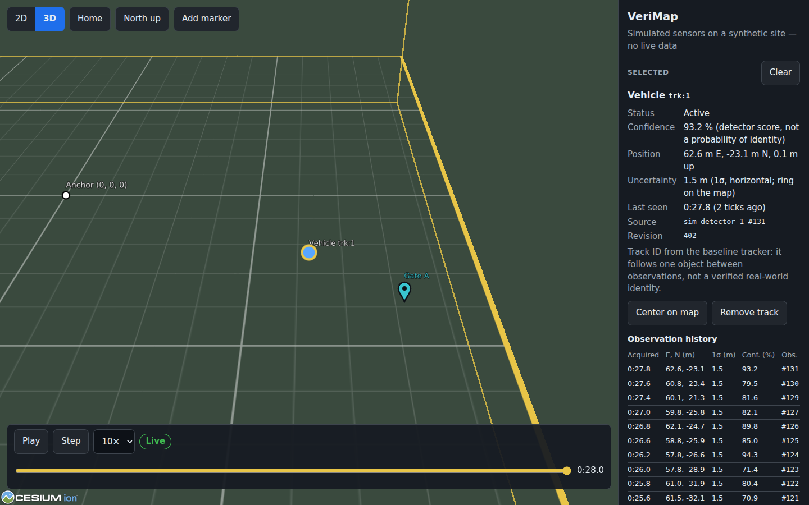
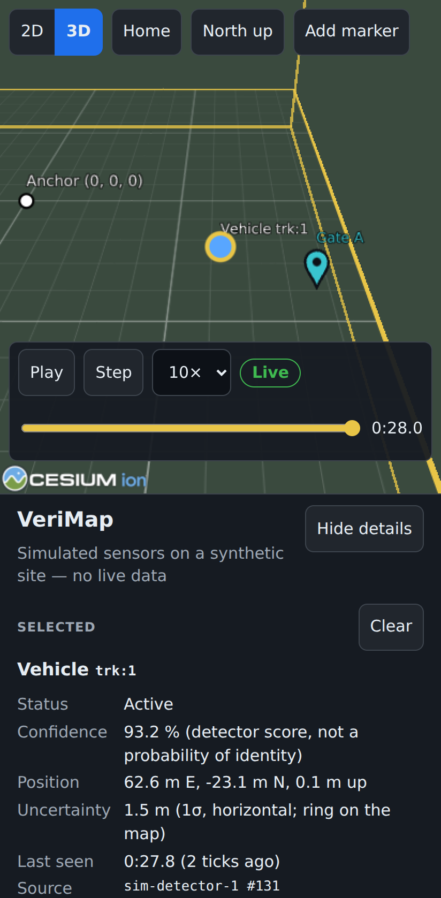

# VeriMap

Interactive 2D/3D mapping with incremental, sensor-driven updates. An
operator explores a scene, inspects detected entities, edits annotations and
map geometry, and sees what changed, when, and why. The first target is a
hardware-free proof of concept: deterministic simulation and recorded-data
replay in the browser, on desktops and touchscreen phones.

- **Rust** holds the domain behavior: validation, update policies, scene
  state, and simulation. The browser runs it as WebAssembly in a Web Worker.
- **Charon → Aeneas → Lean 4** check selected properties of a small Rust
  kernel (`crates/verimap-kernel`) against a model regenerated from the
  production source.
- **React + CesiumJS** handle presentation only, with one engine for 2D and
  3D.
- **Nix flakes** pin the toolchain.

This is early work. [`docs/status.md`](docs/status.md) is the only place that
records what works. [`CLAUDE.md`](CLAUDE.md) is the specification, not a list
of features. [`docs/verification.md`](docs/verification.md) lists exactly
what has been proved and what each proof assumes.

<p>
  
  
</p>

The bundled synthetic site after about 30 s of simulated scene time. The
`trk:1` vehicle track is selected, showing its confidence, 1σ uncertainty,
provenance, and observation history, with an operator marker beside it.
All data is simulated. Both images come from the production build in
headless Chromium with software WebGL. The phone image uses Chromium's
Pixel 7 emulation, not a real device.

## Requirements

- Linux (NixOS or another distribution) or Linux under WSL2. No other
  development platform has been verified.
- Nix with flakes enabled (`experimental-features = nix-command flakes`).
- Optional: [direnv](https://direnv.net/) to enter the shell on `cd`
  (`.envrc` is provided; run `direnv allow` once).
- On a multi-user Nix daemon, add this to the daemon's `nix.conf` and
  restart it. `http2` and the cache public key are restricted: an untrusted
  user cannot set them from the flake, and without them a cache resume can
  fail the shell while Charon is built from source. See
  [ADR 0001](docs/adr/0001-toolchain.md). CI writes the same lines into the
  runner's `nix.conf`.

  ```
  http2 = false
  fallback = true
  extra-substituters = https://hacl.cachix.org
  extra-trusted-public-keys = hacl.cachix.org-1:FzsZ2xsByOwKwIWNPII7yMOelJNDZ12mDAj3d1eGX0c=
  ```

Using the app needs only a current browser; it does not need Nix.

## First run

```sh
nix develop --accept-flake-config   # or: direnv allow
just proofs-cache                    # once: fetch Mathlib's prebuilt Lean cache
just dev                             # http://127.0.0.1:5173
```

The first run downloads, at the pinned versions:

| Tool | Fetches | Pinned by |
| --- | --- | --- |
| Nix | nixpkgs, Aeneas/Charon sources, the Rust nightly, Node, pnpm, Playwright's Chromium | `flake.lock` |
| Cargo | crates from crates.io | `Cargo.lock` |
| pnpm | packages from the npm registry | `web/pnpm-lock.yaml` |
| elan | the Lean toolchain from GitHub releases | `proofs/lean-toolchain` |
| Lake | Aeneas's Lean library, Mathlib, and its dependencies from GitHub; Mathlib's build cache | `proofs/lake-manifest.json` |

Lake builds Aeneas's Lean library locally on the first `just proofs`. Nix
builds Aeneas itself if no cache has it. Pinned downloads are not the same as
a fully offline or fully Nix-built toolchain. Development without network
access after these fetches has not been tested yet.

The default scene makes no network requests: no Cesium ion, geocoder, CDN,
imagery service, or telemetry. Cesium's static assets are copied from
`node_modules` into the build.

## Commands

Run inside `nix develop`. Run `just` to list recipes.

| Command | What it does | Available |
| --- | --- | --- |
| `just dev` | Build the WASM core, serve the web demo on 127.0.0.1:5173, and rebuild WASM when Rust changes | yes |
| `just build` | Production build into `web/dist` | yes |
| `just demo-lan` | Phone-accessible development server over trusted local HTTPS | **not yet** |
| `just fmt` / `just fmt-check` | Rust, Nix, and web formatting | yes |
| `just lint` | Clippy (native and wasm32), `tsc -b`, ESLint | yes |
| `just test` | Rust tests (including property tests) and Vitest | yes |
| `just coverage` | Production Rust line coverage, and 100% line/branch coverage of the pure web modules | yes |
| `just test-wasm` | Shared-core fixtures in a real browser WASM runtime | **not yet** |
| `just e2e` | Playwright against a production build (desktop and emulated mobile Chromium) | yes |
| `just gen` | Regenerate `schemas/` and `web/src/generated/` from `verimap-protocol` | yes |
| `just extract` / `just translate` | Charon LLBC, then the Aeneas Lean model, for the kernel only | yes |
| `just proofs` / `just audit` | `lake build`, then the theorem-axiom and placeholder audit | yes |
| `just check-generated` | Fail on stale, edited, missing, extra, or untracked generated files | yes |
| `just toolchain-check` | Exact-match tool pairs agree (wasm-bindgen, Playwright, Lean/Aeneas) | yes |
| `just bench` | Reference scenario with machine-readable measurements | **not yet** |
| `just verify` | Every available check above, including coverage, plus `e2e` | yes |

`just verify` does not include `demo-lan`, `test-wasm`, or `bench` until
those recipes exist.

## Layout

```text
crates/verimap-kernel/    # extracted to Lean; no_std, no dependencies
crates/verimap-domain/    # scene store, commands/events, journal, replay, tracker; uses the kernel
crates/verimap-protocol/  # wire DTOs, bounded parsing, JSON Schema generation
crates/verimap-sim/       # seeded synthetic site, simulated detector, local session
crates/verimap-wasm/      # browser bindings; no domain logic of its own
web/                      # React + Cesium client, worker bridge, e2e tests
proofs/                   # Lean project: generated Code/, Spec/, Properties/, Audit
schemas/                  # generated JSON Schemas (committed)
fixtures/                 # expected replay state hashes shared by Rust and browser tests
scripts/                  # translation, audit, generated-file and toolchain checks
docs/                     # status, verification, protocol, coordinates, ADRs
```

## Documentation

- [Implementation status](docs/status.md)
- [Verification ledger](docs/verification.md)
- [Worker bridge protocol](docs/protocol.md)
- [Coordinates and units](docs/coordinates.md)
- [ADR 0001: toolchain pins](docs/adr/0001-toolchain.md)

## License

MIT; see [LICENSE](LICENSE).
